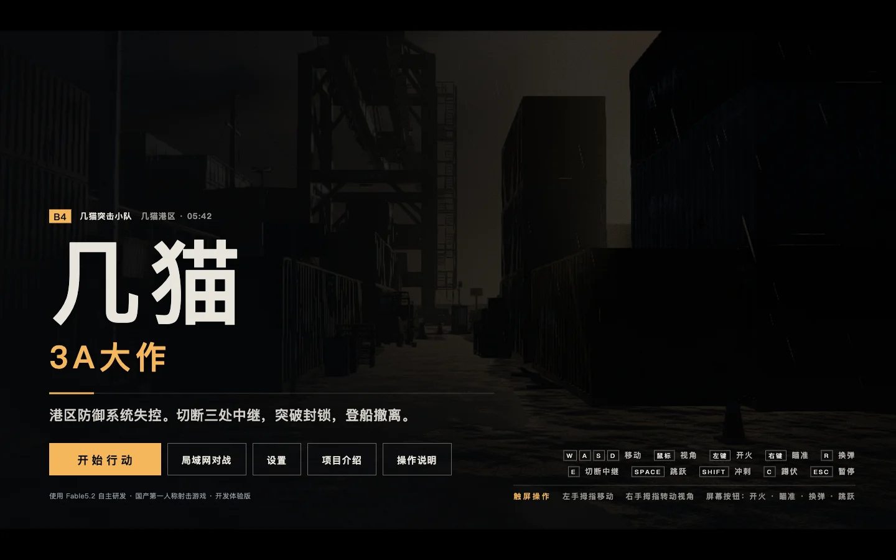
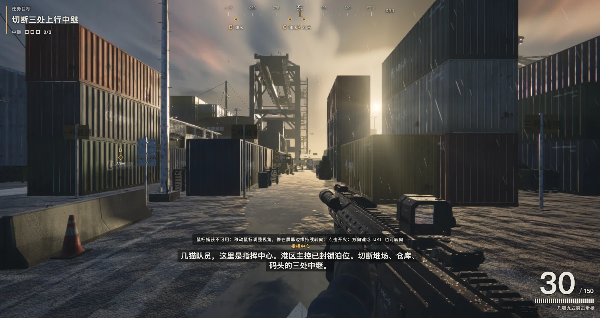
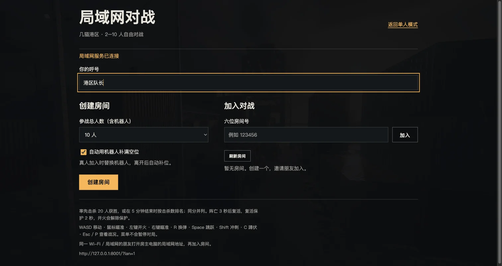
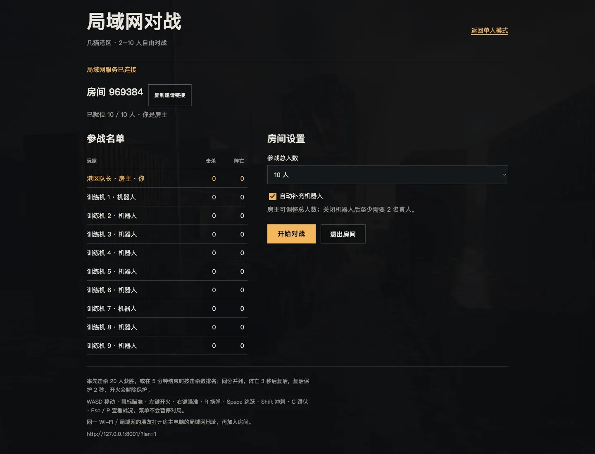
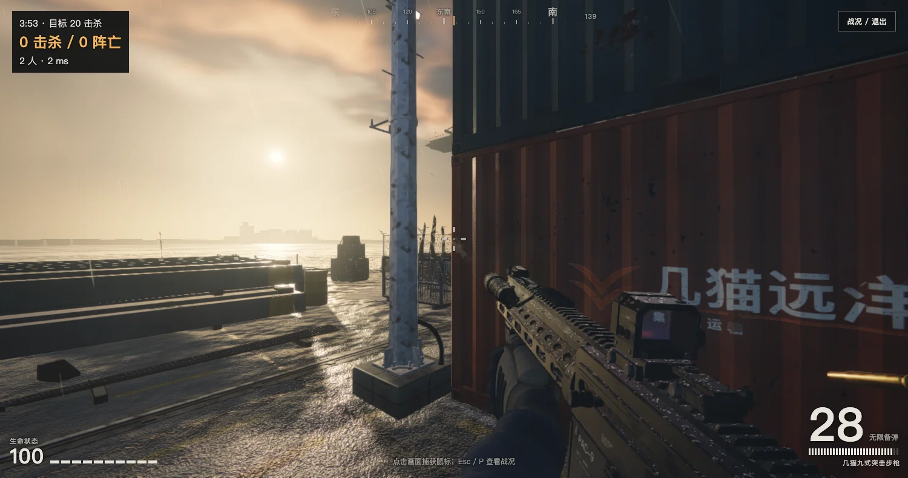
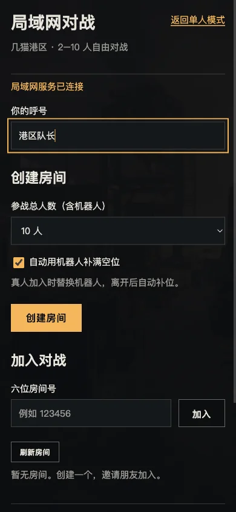

# JIMAO · 几猫

一款在浏览器中运行的第一人称射击（FPS）游戏开发体验版。深入失控的港区，切断中继、突破机械守卫的封锁，登船撤离。

页面中的中文标题为「几猫3A大作」。保留原有单人行动模式，并新增 **2–10 人局域网自由对战**，支持机器人自动补位。



*以下图片均为当前版本的浏览器实机截图，使用低画质设置；房间号和比分仅用于演示。*

## 游戏背景与目标

清晨 05:42，几猫港区的防御系统失控，四号泊位遭到封锁。你将作为突击队员独自进入港区：

1. 找到堆场、仓库和码头的三处上行中继，靠近并按住交互键切断连接。
2. 应对空中的机械飞鸥与地面的机械猎犬；每次切断中继都会引来新的敌人。
3. 切断全部中继后，前往码头南端舷梯旁的撤离艇完成任务。

任务结束后可查看用时、命中率、摧毁机械数量、重试次数和行动评级。



*单人行动：在港区寻找三处上行中继，突破机械守卫的封锁。*

## 快速开始

克隆仓库，并使用 Python 3 启动本地静态服务器：

```bash
git clone https://github.com/web3gaoyutang/JIMAO.git
cd JIMAO
python3 -m http.server 8000 --bind 127.0.0.1
```

在浏览器中打开 <http://localhost:8000>，点击「开始行动」。停止服务器时，在终端按 `Ctrl + C`。

也可以尝试直接双击 `index.html` 打开；推荐通过本地服务器运行，以减少浏览器对本地文件的限制。

单人模式无需安装 npm 依赖或执行构建。请使用支持 WebGL 2 的现代浏览器，并启用硬件加速。性能取决于设备与浏览器；运行不流畅时可在设置中降低画质。

## 局域网对战（2–10 人）

房主电脑安装 **Node.js 22 或更新版本**，在项目目录运行：

```bash
npm install
npm start
```

服务默认监听 `0.0.0.0:8000`，终端会显示本机地址与局域网地址。房主和其他玩家使用浏览器打开终端显示的局域网地址，例如 `http://192.168.1.20:8000/?lan=1`。也可在首页点击「局域网对战」。其他设备不能使用 `localhost` 或 `127.0.0.1` 连接房主。

- 房主输入呼号，选择 **2–10 人总席位**，创建房间。朋友从房间列表加入，或输入六位房间号。
- 开启「自动用机器人补满空位」后，1 名真人也能与机器人开局；关闭后至少需要 2 名真人。
- 真人中途加入会替换一个机器人；真人离开后自动补位。真人数量达到席位上限时拒绝新玩家。
- 房主点击「开始对战」。自由混战，率先取得 **20 次击杀**获胜；**5 分钟**到时按击杀数排名，同分并列。
- 阵亡 **3 秒**后自动复活，复活有 **2 秒**保护；开火立即解除保护。每匣 30 发，备弹无限，需要换弹。对战模式使用步枪，不包含单人任务交互和近战伤害。
- `Esc` / `P` 或「战况 / 退出」打开战绩及退出菜单，**不会暂停服务器上的对局**。房主离开后自动移交给下一位真人；最后一位真人离开后销毁房间。
- 对局结束后房主可调整人数及机器人选项，再来一局。关闭机器人且只剩一名真人时，本局结束。

### 联机画面



*创建或加入房间：设置呼号与总人数，也可以使用六位房间号加入朋友。*



*10 人房间示例：1 名真人 + 9 台机器人。朋友加入时自动替换机器人。*



*双人对战实测：左上角显示倒计时、击杀与阵亡，生命及弹药位于画面下方。*

### 连接与排障

玩家需处于可互相访问的同一局域网，允许房主电脑防火墙的 TCP 8000 端口。访客 Wi-Fi 的客户端隔离可能阻止连接。端口被占用时，macOS / Linux 使用 `PORT=8080 npm start`；PowerShell 使用 `$env:PORT=8080; npm start`。

联机需要持续运行 Node.js 服务。Python 静态服务器和 GitHub Pages 只支持单人模式；联机页面会提示连接失败。断线后点击「重新连接」，重新加入房间；个人比分不保留。复制邀请链接在 HTTP 环境无法访问剪贴板时会显示可手动复制的地址。

## 操作方式

### 键盘与鼠标

| 操作 | 按键 |
| --- | --- |
| 移动 | `W` / `A` / `S` / `D` |
| 调整视角 | 鼠标 |
| 开火 | 鼠标左键 |
| 瞄准 | 鼠标右键 |
| 换弹 | `R` |
| 切断中继 | 靠近后按住 `E` |
| 跳跃 | `Space` |
| 冲刺 | `Shift` |
| 蹲伏 | `C` / `Ctrl` |
| 近战 | `F` / `V` |
| 暂停 | `Esc` / `P` |

进入游戏后，点击画面以捕获鼠标；`Esc` 可释放鼠标。若无法捕获鼠标，请按游戏内提示操作；也可用方向键或 `I` / `J` / `K` / `L` 调整视角。

### 触屏

- 左手拇指在屏幕左侧滑动以移动，将摇杆推到最前方可冲刺。
- 在屏幕右侧拖动以调整视角。
- 使用屏幕按钮开火、瞄准、换弹和跳跃；靠近中继后按住「交互」。



*窄屏布局预览（390 像素宽）：大厅纵向排列，可滚动访问全部设置。*

### 手柄

游戏内包含手柄输入支持，实际兼容性取决于设备和浏览器：双摇杆移动与转向，`RT` 开火，`LT` 瞄准，`A` 跳跃，`B` 蹲伏，`X` 换弹，`Y` 切断中继，`L3` 冲刺，`Start` 暂停。

## 游戏设置

游戏内可调整画面质量、鼠标灵敏度、垂直视角反转、主音量、视野范围及全屏显示。

## 文件与技术

```text
JIMAO/
├── index.html        # 原有单人游戏与 Three.js，含联机入口和初始化接点
├── server.mjs        # HTTP 静态服务、WebSocket 连接与房间分发
├── lan/
│   ├── entry.js      # 按需加载联机客户端
│   ├── client.mjs    # 大厅、预测移动、远端角色和对战 HUD
│   ├── style.css     # 局域网界面样式
│   ├── room.mjs      # 服务端房间、机器人、伤害与对局生命周期
│   ├── shared.mjs    # 前后端共用移动碰撞、弹道和寻路
│   └── harbor.json   # 固定种子港区碰撞盒、导航网格和出生点
├── scripts/export-lan-map.js # 原地图变更后的数据导出工具
├── test/             # 游戏规则与真实 WebSocket 集成测试
├── docs/images/      # README 使用的实机截图（WebP）
└── README.md
```

游戏使用 Three.js / WebGL 渲染三维港区，并包含程序化场景与材质、武器战斗、机械敌人、任务流程、音效和游戏界面。联机模式复用同一港区和武器模型，固定地图种子为 `4207`，对战范围限制在港区陆地。服务端以 30 Hz 计算移动、机器人和战斗，以 15 Hz 广播状态；客户端预测本地移动并插值远端角色。客户端只发送操作和射击方向，生命、弹药、命中、比分及复活由服务端判定。机器人使用港区导航网格绕开障碍物，并通过视线判断选择目标。

## 静态部署

将 `index.html` 和 `lan/` 放入静态站点即可运行单人模式，无需构建。局域网对战必须通过 `npm start` 提供 HTTP 和 WebSocket 服务，不能仅靠静态托管。

如需使用 GitHub Pages，可在仓库的 **Settings → Pages** 中选择 **Deploy from a branch**，然后选择 `master` 分支的根目录 `/ (root)` 并保存。推送文件本身不会自动启用 Pages，访问地址以设置页面显示的结果为准。

## 开发与验证

```bash
npm test
```

测试覆盖席位边界、房主权限及移交、机器人补位、射击校验、遮挡、换弹、死亡复活、结算、移动碰撞与寻路；集成测试通过真实 WebSocket 连接验证 10 个真人入房、超员拒绝、中途替补、房间隔离和静态资源边界。

原有游戏代码为内嵌压缩包；新功能独立放在 `lan/`，通过 `window.createLanGame` 接入初始化流程，避免重写原游戏。修改原港区几何后，应以 `/?q=low&seed=4207` 启动单人页面，等待载入完成，在浏览器控制台运行 `scripts/export-lan-map.js`，用下载文件替换 `lan/harbor.json` 并更新其 `version`；随后运行测试，确认客户端和服务端地图一致。

## 项目状态

当前为开发体验版，画面表现、性能和设备兼容性仍可持续优化。欢迎通过 [Issues](https://github.com/web3gaoyutang/JIMAO/issues) 反馈问题，并提供浏览器版本、设备信息、复现步骤及控制台报错（如有）。
